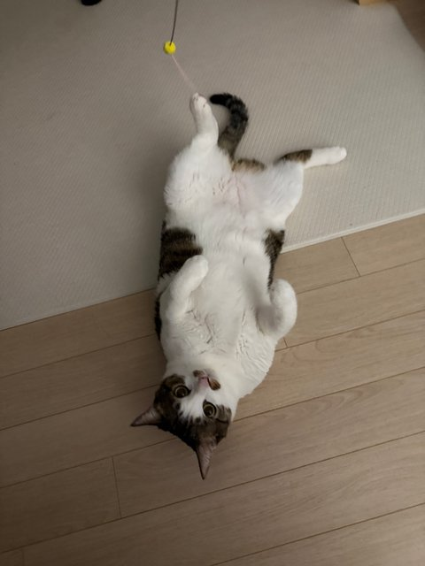

<p align="center"></p>

# ㅎㅇ 형부 형부가 cms 연동 할 때 폴더 구조 보느라 복자배 할까봐 리드미를 만들었어요 보고 배포할 땐 리드미를 삭제하거나 올리는 파일에서 제외하고 올려주시면 될듯??^^.리드미 너무 복잡하면 아무것도 안읽으셔도 됩니다 다만 물결 애니메이션 안뜨면 아래 참고해주세요 그래도 안되면 저한테 말해주세요 CMS연동하면서 추가 설정 없는 방식으로 다시 구현해서 dream. 그럼 20000

React 19 + styled-components + GSAP 기반

> VS Code Live Server로 index.html 직접 열면 안 돌아감!! 꼭 `npm run dev` or `npm.cmd run dev`로 켜야 함

## ⚠️ CMS 연동 후 배경 물결이 안 뜰 때 (사진만 뜰 때)

Hero · Visual · About 배경 물결은 WebGL이 **이미지 픽셀을 직접 읽어서** 일그러뜨리는 방식으로
CMS 이미지가 다른 도메인(CDN 등)에 있으면 브라우저 보안(CORS) 때문에 막혀서 **물결 없이 정적 사진만** 보일 수 있음. 화면이 깨지진 않음

### 1. 원인 확인
F12 → Console 탭에 아래 같은 게 뜨면 CORS 문제 맞음
```
[WaterCanvas] 물결 이미지 불러오기 실패함, 정적 이미지로 보여줌
SecurityError: Failed to execute 'texImage2D' ... cross-origin data ...
```

### 2. 해결 방법 (위에서부터 순서대로 시도)

**① CMS가 CORS 허용하는 경우 → 코드 한 줄 추가** (Sanity, Contentful, Cloudinary, Strapi+S3 등 대부분 됨)

`src/components/effects/WaterCanvas/index.jsx`의 `loadImage` 함수에 `crossOrigin` 추가
```js
const loadImage = (src) =>
  new Promise((resolve, reject) => {
    const image = new Image();
    image.crossOrigin = "anonymous"; // ← 이 줄만 새로 추가 (꼭 아래 image.src 줄보다 위에 써야 함)
    image.onload = () => resolve(image);
    image.onerror = reject;
    image.src = src;
  });
```
추가했는데 이미지 자체가 아예 안 뜨면 CMS 쪽이 CORS를 안 보내는 거 → ②로

**② CMS(이미지 서버)에서 CORS 허용 설정**

이미지 응답 헤더에 아래가 들어가게 CMS / CDN / S3 설정에서 허용 (설정 후 ① 코드도 필요)
```
Access-Control-Allow-Origin: *        (또는 우리 사이트 도메인)
```
- S3: 버킷 → 권한 → CORS 구성에 `AllowedOrigins`, `GET` 추가
- 워드프레스 / 직접 만든 서버: 업로드 폴더 응답에 위 헤더 추가

**③ 배경 3장만 로컬 이미지 유지 (설정 못 건드릴 때 제일 쉬움)**

물결 들어가는 배경(`hero-ocean`, `visual-underwater`, `about-shore`)만 지금처럼 `src/assets/img`에 두고, 작품·대표작 이미지만 CMS에서 받으면 CORS 신경 안 써도 됨 (작품 카드 hover 효과는 CORS 상관없음)

**④ 그래도 안 되면 → CORS 무관 방식으로 교체 요청**

이미지 일렁임은 SVG 필터로, 빛·파문은 이미지 안 쓰는 WebGL 빛 레이어로 나누는 방식으로 바꿀 수 있음 (CORS 완전 무관, 대신 클릭 파문 때 사진이 휘는 느낌은 조금 약해짐)

## 물 인터랙션 관련 

| 효과 | 위치 | 구현 |
| --- | --- | --- |
| 흐르는 수면 · 커스틱 빛 · 커서 잔물결 · 클릭/빗방울 파문 | Hero, Visual, About 사진 | `components/effects/WaterCanvas` (WebGL 셰이더) |
| 물결 경계로 차오르는 화면 전환 | 모든 섹션 이동 | `utils/transitions.js`, `utils/wave.js` (clip-path) |
| 이미지 hover 시 수면 왜곡 | 작품 카드, 대표 작품 | `components/effects/WaterFilter` (SVG 필터) |
| 흐르는 파도 라인 | Intro, Manifesto, Contact, 모바일 메뉴 | `components/effects/FlowingWaves` |
| 출렁이는 타이틀 글자 | Hero | `components/effects/WavyText` |
| 클릭 시 물방울 동심원 | 전체 | `components/effects/ClickRipple` |

`prefers-reduced-motion` 설정 시 모든 모션이 꺼지고 정적 이미지로 대체됨요

> ⚠️ 배경 물결은 외부 도메인(CMS) 이미지 쓰면 CORS 허용 필요함 → 맨 위 [CMS 연동 후 배경 물결이 안 뜰 때](#️-cms-연동-후-배경물결이안뜰때사진만뜰때) 참고

## 폴더 구조

```
web/
├─ index.html          진입 HTML (폰트, 파비콘, #root 만 있음)
├─ vite.config.js      Vite 설정
├─ package.json        의존성 / 실행 스크립트
└─ src/
   ├─ main.jsx         React 시작점 (App 렌더)
   ├─ App.jsx          전체 조립 — Provider들 감싸고 Header·패널·모달 배치
   ├─ assets/
   ├─ components/
   ├─ sections/
   ├─ contexts/
   ├─ hooks/
   ├─ constants/
   ├─ styles/
   └─ utils/
```

### `src/assets/img/` — 이미지 모아두는 곳
- 전부 PNG. 쓰는 파일에서 `import heroOcean from "../../assets/img/hero-ocean.png"` 처럼 상대경로로 불러옴
- `hero-ocean` 메인 바다 / `visual-underwater` 수중 화면 / `about-shore` 작가 소개 사진
- `featured-*` 대표 작품 2개 / `work-*` 아카이브 작품 6개
- 이미지 바꾸고 싶으면 같은 이름으로 덮어쓰면 끝

### `src/constants/` — 데이터는 여기 다 있음
텍스트나 작품 바꿀 땐 거의 여기만 건드리면 됨

| 파일 | 내용 |
| --- | --- |
| `artworks.js` | 아카이브 작품 목록 (제목·카테고리·연도·이미지·설명), 필터 카테고리, 한 페이지당 작품 수 |
| `content.js` | 작가 이름·이메일·연도, 대표 작품(Selected Works), 전시 이력 |
| `navigation.js` | 상단/모바일 메뉴 항목 (메뉴 이름, 이동할 섹션 id) |

### `src/sections/` — 화면(풀페이지 한 장) 단위
- `index.jsx` ⭐ **화면 순서랑 구성 정하는 파일**. `SECTIONS` 배열 순서 = 화면 순서
  - 섹션 추가 / 순서 바꾸기 / 배경색·밝은톤(light) 바꾸기 → 여기서
  - Intro·Manifesto 문구, Archive 제목도 여기 props로 들어가 있음
- 각 폴더 = 화면 하나

| 폴더 | 화면 |
| --- | --- |
| `Hero/` | 첫 화면 (WebGL 바다 + 출렁이는 이름) |
| `Statement/` | 큰 문장 + 설명 화면. Intro랑 Manifesto가 같이 씀 |
| `SelectedWorks/` | 대표 작품 2개 |
| `Archive/` | 작품 아카이브 (필터 + 그리드). archive1, archive2 두 장이 같이 씀 |
| `Visual/` | 수중 빛 일렁이는 중간 화면 |
| `About/` | 작가 소개 |
| `Exhibitions/` | 전시 이력 리스트 |
| `Contact/` | 연락처 + 푸터 |

### `src/components/` — 여러 군데서 쓰는 부품들
- **`common/`** 공통 부품
  - `Panel` 풀페이지 한 장 껍데기. 보임/숨김, 진입 애니메이션(`data-animate` 붙은 애들 순서대로 등장), 밝은/어두운 톤 처리
  - `Container` 좌우 여백 잡아주는 래퍼
  - `SectionHead` 섹션 상단 (라벨 + 큰 제목 + 설명)
  - `ArrowLink` "DISCOVER THE ARTIST ↗" 같은 이동 링크
  - `Typography` Label, SectionTitle, Accent(하늘색 강조) 글자 스타일
- **`layout/`** 화면에 고정으로 떠 있는 것들
  - `Header` 상단 바 + 메뉴 + 햄버거 버튼
  - `MobileNav` 모바일 전체화면 메뉴
  - `PageIndicator` 오른쪽 점, 오른쪽 아래 페이지 번호, 가운데 아래 ↓ 버튼
- **`artwork/`** 작품 관련
  - `FilterBar` ALL / PAINTING / PHOTOGRAPHY / MIXED 버튼
  - `ArtCard` 작품 카드 하나 / `ArtGrid` 카드 3개 그리드
  - `ArtworkModal` 작품 눌렀을 때 뜨는 상세 팝업
- **`effects/`** 물 효과 (위 표 참고)
  - `WaterCanvas/shaders.js` 물결 셰이더 코드. 배경 물결 속도·세기 조절은 여기 숫자 바꾸면 됨
  - `WaterCanvas/createWaterRenderer.js` WebGL 그리는 엔진 (React랑 상관없는 순수 JS)

### `src/contexts/` — 전역 상태
- `FullpageContext.jsx` 지금 몇 번째 화면인지, 화면 이동(`goTo`, `goToId`), 이동 잠금(모달·메뉴 열렸을 때 스크롤 막기), 주소창 `#해시` 동기화
- `ArtworkContext.jsx` 선택한 필터, 필터된 작품 목록, 모달에 띄울 작품

### `src/hooks/` — 재사용 로직
| 파일 | 하는 일 |
| --- | --- |
| `useWheelNavigation` | 마우스 휠 한 번 → 한 화면 이동 |
| `useSwipeNavigation` | 모바일 위/아래 스와이프로 이동 |
| `useKeyboardNavigation` | ↑↓ / PageUp·Down / Home·End 로 이동 |
| `useSectionLink` | `<a href="#about">` 누르면 풀페이지 전환으로 이동하게 해줌 |
| `useFocusTrap` | 모달·메뉴 열렸을 때 Tab 포커스가 밖으로 안 나가게 |
| `usePrefersReducedMotion` | "동작 줄이기" 설정 켜져 있는지 체크 |
| `useLatest` | 이벤트 리스너에서 최신 값 읽게 해주는 ref |

### `src/styles/` — 스타일 기본값
- `theme.js` 색상, 폰트, z-index, 밝은/어두운 톤 색 (색 바꾸려면 여기)
- `GlobalStyle.js` 전체 리셋 CSS + `--side`(좌우 여백), `--header`(헤더 높이) 변수
- `media.js` 반응형 브레이크포인트 (`media.mobile` = 768px 이하 등)
- `mixins.js` 자주 쓰는 스타일 조각 (serif 폰트, 라벨 글자, 동그란 버튼)
- `layout.js` 풀페이지 main 래퍼

### `src/utils/` — 순수 함수 (React 없음)
- `transitions.js` 섹션 넘길 때 전환 애니메이션. **`PANEL_DURATION` = 전환 시간**
- `wave.js` 전환 물결 모양 계산. **`MAX_WAVE_HEIGHT` = 물결 높이**
- `archive.js` 작품 필터링, 아카이브 1·2 페이지 나누기
- `format.js` 페이지 번호 `01 / 10` 포맷
- `motion.js` 동작 줄이기 설정 감지

## 규칙
- 컴포넌트 폴더는 `index.jsx`(마크업/로직) + `styles.js`(styled-components)로 분리
- 섹션 추가/순서 변경은 `src/sections/index.jsx`의 `SECTIONS` 배열만 수정
- 텍스트·작품 데이터는 컴포넌트에 직접 박지 말고 `constants/`에

## 자주 하는 수정 빠른 찾기
| 하고 싶은 거 | 파일 |
| --- | --- |
| 작품 추가/수정 | `constants/artworks.js` (+ 이미지는 `assets/img/`) |
| 이메일·작가 이름 | `constants/content.js` |
| 메뉴 바꾸기 | `constants/navigation.js` |
| 화면 순서·배경색 | `sections/index.jsx` |
| 섹션 넘김 물결 속도/높이 | `utils/transitions.js`, `utils/wave.js` |
| 배경 물결 속도/세기 | `components/effects/WaterCanvas/shaders.js` |
| 전체 색상 | `styles/theme.js` |
